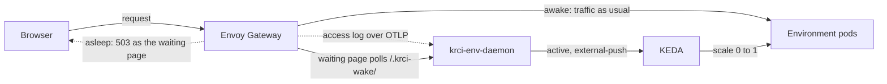

# krci-env-daemon

[](https://opensource.org/licenses/Apache-2.0)

Wakes KubeRocketCI environments that KEDA scaled to zero on the first request to them, and shows a waiting page while they start.



- **Not in the request path.** Envoy routes to the pods as before and sends the daemon a copy of its access log. The daemon maps the request host to an environment through the environment's HTTPRoutes.
- **KEDA scales.** The daemon is a KEDA external-push scaler. The first request pushes "active" and the workloads start at once; after the idle window without requests KEDA scales them to zero. A running Tekton pipeline counts as use.
- **Waiting page.** While a route has no ready endpoints, Envoy answers with a page that shows the workloads starting and opens the original URL when all of them are Ready.
- **Start order.** The annotation `krci.epam.com/wake-after: <deployment>` on a ScaledObject starts its workload after that Deployment is Ready, or after `wakeAfterTimeout`.
- **Stateless.** One pod per cluster, no volumes. The state of each environment is kept in a Lease, so a restart changes nothing.

## Prerequisites

Envoy Gateway v1.9 or later, KEDA 2.17 or later, and HTTPRoutes for the environments, accepted by the Gateway named in the chart's `gateway` values.

## Install

1. Install the chart with the environments it serves:

   ```bash
   helm install krci-env-daemon deploy-templates -n krci-env-daemon --create-namespace \
     --set 'environments[0].namespace=team-a' \
     --set 'environments[0].route=krci-portal' \
     --set 'environments[0].hostnames[0]=portal-team-a.example.com'
   ```

2. Send the access log to the daemon from the Gateway's `EnvoyProxy`. Do it after step 1: Envoy Gateway rejects the Gateway while the sink Service does not exist.

   ```yaml
   spec:
     telemetry:
       accessLog:
         settings:
           - format:
               type: JSON
               json:
                 authority: "%REQ(:AUTHORITY)%"
                 response_code: "%RESPONSE_CODE%"
             sinks:
               - type: OpenTelemetry
                 openTelemetry:
                   backendRefs:
                     - name: krci-env-daemon
                       namespace: krci-env-daemon
                       port: 4317
   ```

3. Give each workload of an environment a ScaledObject with the daemon's label and trigger:

   ```yaml
   apiVersion: keda.sh/v1alpha1
   kind: ScaledObject
   metadata:
     name: krci-portal
     namespace: team-a
     labels:
       krci.epam.com/env-daemon: enabled
   spec:
     scaleTargetRef:
       name: krci-portal
     minReplicaCount: 0
     maxReplicaCount: 1
     cooldownPeriod: 300
     triggers:
       - type: external-push
         metadata:
           scalerAddress: krci-env-daemon.krci-env-daemon.svc:9090
   ```

Chart values: [deploy-templates/README.md](deploy-templates/README.md).

## Limitations

- A webhook that reaches a sleeping environment wakes it but is not delivered: send it again once the environment is up.
- An open Portal tab keeps calling the Portal, so it keeps its environment awake.
- A ScaledObject with the daemon's trigger must scale a Deployment in a namespace the daemon watches. Otherwise the daemon answers with an error, and KEDA keeps the replicas and reports the trigger error.
- An environment has at most 64 workloads. The access-log sink must send batches below 256 KiB; Envoy's default flush size is 16 KiB.

## Develop

See [CLAUDE.md](./CLAUDE.md). `make test` runs the linter, the unit tests and the chart render tests (skipped without `helm`); `make build` produces `dist/krci-env-daemon-<arch>`.

## Security

See the [Security Policy](SECURITY.md).

## License

This project is licensed under the Apache License 2.0, see the [LICENSE](LICENSE) file for details.
